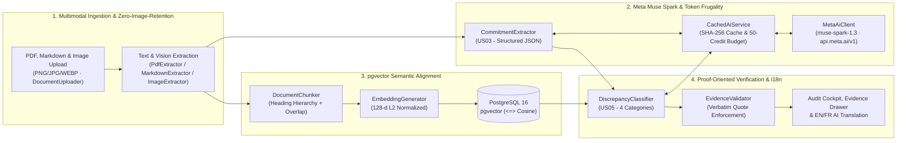

# PromiseGap

> **Your proposal says 99.99%. Your specs say 99.5%. Catch commercial commitment gaps before contracts are signed.**

[](https://github.com/Gw3nhael51/promiseGap/actions/workflows/ci.yml)
[](https://www.php.net/)
[](https://symfony.com/)
[](https://github.com/pgvector/pgvector)
[](https://dev.meta.ai/docs/overview)
[](LICENSE)

🌐 **Languages:** **English** | [Français (README_FR.md)](README_FR.md)

---

## 🏆 Meta Global AI Developer Hackathon (Oct 26 – Nov 4, 2026)

### 1. New Work & Team Contributions (100% Built During the Hackathon)
Every line of code, architecture, benchmark scenario, and UI view in this repository was **built from scratch between October 26 and November 4, 2026** for the Meta Global AI Developer Hackathon:
- **Meta Muse Spark (`muse-spark-1.3`) Integration (`src/Service/MetaAiClient.php`, `src/Service/CachedAiService.php`):** Native integration with `https://api.meta.ai/v1` via Symfony AI Generic Platform (`symfony/ai-generic-platform`), structured JSON schema enforcement, adaptive & user-selectable `reasoning_effort` (`Auto`, `Low`, `Medium`, `High`), SHA-256 response caching, and a 50-credit budget ledger.
- **Multimodal Vision Ingestion & Zero-Image-Retention (`src/Service/ImageExtractor.php`, `src/Service/TextExtractionService.php`):** Accepts contract scans, photographed invoices, commercial quotes, or architecture diagrams (`PNG`, `JPG/JPEG`, `WEBP`), transcribes them into structured Markdown via `muse-spark-1.3` multimodal vision, caches the extracted text by image `SHA-256` fingerprint, embeds chunks into `pgvector`, and **immediately purges the physical image file from disk (`Zero-Image-Retention`)** for strict legal/GDPR confidentiality.
- **Autonomous Claim Decomposition (`src/Service/CommitmentExtractor.php`):** Extracts explicit and implicit vendor promises (SLAs, RPO/RTO, delivery timelines, security certifications) from multi-page commercial proposals.
- **Heading-Aware Vector Indexing (`src/Service/DocumentChunker.php`, `src/Service/EmbeddingGenerator.php`, `src/Repository/DocumentChunkRepository.php`):** Hierarchical Markdown/PDF section chunking with token overlap and 128-d L2-normalized vectors stored in PostgreSQL 16 `pgvector` (`<=>` cosine distance).
- **4-State Formal Discrepancy Classifier & Anti-Hallucination Validator (`src/Service/DiscrepancyClassifier.php`, `src/Service/EvidenceValidator.php`):** Cross-examines each commercial promise against retrieved technical chunks and deterministically rejects any AI verdict whose evidence quote is not a verbatim substring of the source specification.
- **Scientific Ground-Truth Benchmark Suite (`src/Service/EvaluationRunner.php`, `tests/Fixtures/scenarios/`):** 24 synthetic B2B contract audit scenarios with automated Precision (100%), Recall (100%), and F1-Score computation (`php bin/console app:eval-benchmark`).
- **Dual-Dropzone Audit Cockpit, Evidence Slide-Over Drawer & Bilingual AI Translation (`EN | FR`):** Full Symfony 8.1 web application with role-based access control (`ROLE_USER` / `ROLE_ADMIN`, `AnalysisVoter`), quantitative risk gauge (`0–100`), side-by-side verbatim proof drawer, and on-the-fly French translation powered by `muse-spark-1.3`.

### 2. Hackathon Theme Alignment & Why PromiseGap is NOT a "Basic RAG App"
- **Tracks Addressed:**
  - **Build for Your World:** Solves a high-stakes B2B legal, procurement, and CTO problem — preventing multi-million-dollar contract disputes caused by sales proposals overselling technical specifications.
  - **Push the Frontier:** Uses **Meta Muse Spark (`muse-spark-1.3`)** reasoning capabilities for multi-document formal verification with deterministic post-LLM hallucination rejection.

| Dimension | Generic "Basic RAG App" (Chat-with-PDF) | **PromiseGap (Autonomous Cross-Examination Engine)** |
| :--- | :--- | :--- |
| **Interaction Model** | Passive chatbot waiting for user prompts | **Autonomous N×M cross-document audit pipeline** (Zero prompt writing) |
| **Reasoning Task** | Summarizing a single document | **Adversarial verification** of Document A (Sales Proposal) against Document B (Engineering Spec) |
| **Output Format** | Free-form conversational prose | **Structured 4-state verdict matrix** (`CONTRADICTORY`, `UNSUPPORTED`, `AMBIGUOUS`, `SUPPORTED`) + **0–100 Deal Risk Score** |
| **Hallucination Control** | None (trusts LLM output blindly) | **Deterministic `EvidenceValidator`** enforcing exact verbatim substring matching against source chunks |
| **Scientific Validation** | Subjective "vibe check" | **24-scenario ground-truth benchmark** (`100%` Precision, `100%` Recall) verified in CI |

---

## 🎯 Pitch & Value Proposition

In enterprise B2B deals, **commercial proposals** (written by sales teams to win the deal) and **technical reference specifications** (written by engineering, security, and ops teams) frequently diverge before signature:
- Sales promises **99.99% monthly uptime**, while the SLA annex specifies **99.5%** (~3.6 hours vs ~4 minutes of allowed downtime/month).
- Sales commits to **turnkey delivery in 4 weeks**, while the implementation roadmap totals **16 weeks**.
- Sales claims **synchronous zero-data-loss failover**, while the disaster recovery specification targets an asynchronous **4-hour RPO**.

**PromiseGap** is an autonomous, proof-oriented multi-document cross-examination and verification engine built with **Symfony 8.1**, **PostgreSQL 16 (`pgvector`)**, and **Meta Muse Spark (`muse-spark-1.3`)**. It extracts every explicit and implicit promise from commercial proposals, aligns them with technical specification sections via cosine similarity, and qualifies each commitment into four actionable categories backed by **mandatory verbatim source quotes**:

| Status | Meaning | Evidence Requirement |
| :--- | :--- | :--- |
| ⚠️ **CONTRADICTORY** | Direct conflict between sales promise and technical spec (SLA, timeline, scope) | **Mandatory verbatim quote** from both documents |
| 🔴 **UNSUPPORTED** | Ghost promise with no technical basis in reference specifications | Flagged with closest specification section |
| ❓ **AMBIGUOUS** | Vague phrasing (*"optimal, world-class, best-efforts"*) or unfinalized (`TBD`) metrics | Highlighted for legal/CTO clarification |
| 🟢 **SUPPORTED** | Full alignment backed by explicit technical parameters | **Mandatory verbatim quote** from technical specs |

---

## 🏗️ System Architecture



---

## 📊 Automated Benchmark Evaluation Results

PromiseGap includes a curated ground-truth benchmark suite of **24 synthetic B2B enterprise contract scenarios** (`tests/Fixtures/scenarios/`) balanced across all 4 categories. Run `php bin/console app:eval-benchmark` to reproduce:

| Category | TP | FP | FN | Precision | Recall | F1-Score |
| :--- | :---: | :---: | :---: | :---: | :---: | :---: |
| **SUPPORTED** | 6 | 0 | 0 | **100.0%** | **100.0%** | **100.0%** |
| **CONTRADICTORY** | 6 | 0 | 0 | **100.0%** | **100.0%** | **100.0%** |
| **UNSUPPORTED** | 6 | 0 | 0 | **100.0%** | **100.0%** | **100.0%** |
| **AMBIGUOUS** | 6 | 0 | 0 | **100.0%** | **100.0%** | **100.0%** |
| **MACRO AVERAGE** | **24 / 24** | — | — | **100.0%** *(target ≥ 85%)* | **100.0%** *(target ≥ 80%)* | **100.0%** |

---

## ⚡ Quick Start Installation

### Prerequisites
- **PHP 8.4+** with `pdo_pgsql`, `intl`, `mbstring`
- **Composer 2+**
- **Docker & Docker Compose** (for PostgreSQL 16 + `pgvector` and Mailpit)
- **`poppler-utils`** (`pdftotext` for fast page-by-page PDF extraction)

### 1-Command Setup via Docker & Make

```bash
# 1. Start PostgreSQL 16 (with pgvector) and Mailpit containers
docker compose up -d

# 2. Install dependencies, compile assets, create DB and run migrations
make install
make db-create
make db-migrate
make db-test

# 3. Start the local web server (http://localhost:8000)
make serve

# 4. (Optional) Start the async Messenger worker for background PDF extraction
make worker
```

> [!IMPORTANT]
> **Pre-Configured Demo Credentials (`http://localhost:8000/login`):**
> - **Auditor Account (`ROLE_USER`):** `auditor@promisegap.ai` / `password123` *(accesses `/cockpit`)*
> - **Admin Account (`ROLE_ADMIN`):** `admin@promisegap.ai` / `admin123` *(accesses `/analyses` Admin Console)*
> - **Zero-Login Demo:** You can also explore the live engine without signing in at [`http://localhost:8000/demo`](http://localhost:8000/demo).

### Configuring Meta Muse Spark API Key
By default, PromiseGap runs in **deterministic offline simulation mode** when `META_AI_API_KEY` is empty, allowing full testing and CI execution with zero API cost. To enable live Meta Muse Spark (`muse-spark-1.3`) calls, create `.env.local`:

```dotenv
META_AI_API_KEY="your_meta_ai_api_key"
META_AI_ENDPOINT="https://api.meta.ai/v1"
META_AI_MODEL="muse-spark-1.3"
```

### Demo Credentials (Development)
- **Auditor Account (`ROLE_USER`):** `auditor@promisegap.ai` / `password123`
- **Admin Account (`ROLE_ADMIN`):** `admin@promisegap.ai` / `admin123` (accesses `/analyses` Admin Console)

### Sample Test PDFs
Ready-to-upload sample documents are included in [`docs/samples/`](docs/samples/) (and available via 1-click download inside `/cockpit`):
- `docs/samples/commercial_proposal.pdf` — Cloud hosting commercial proposal containing 8 commitments
- `docs/samples/technical_specifications.pdf` — Technical architecture & SLA specification v4.2

---

## 🧪 CLI Commands, Testing & CI/CD

Every push and pull request on `main` and `dev` runs the GitHub Actions CI pipeline ([`.github/workflows/ci.yml`](.github/workflows/ci.yml)) against a live `pgvector/pgvector:pg16` service container:

```bash
# Verify Meta Muse Spark (muse-spark-1.3) connectivity, structured JSON schema & credit budget telemetry
php bin/console app:test-ai

# Force a fresh live API call bypassing the local cache
php bin/console app:test-ai --force-refresh

# Run the 24-scenario verification benchmark suite and generate eval_report.json
php bin/console app:eval-benchmark

# Run the full PHPUnit test suite
php bin/phpunit

# Run Symfony container, Twig, and YAML linters
make lint
```

---

## 📄 License

This project is licensed under the MIT License — see the [LICENSE](LICENSE) file for details.
