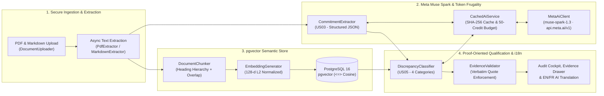

# PromiseGap

> **Your proposal says 99.99%. Your specs say 99.5%. Catch commercial commitment gaps before contracts are signed.**

[](https://github.com/Gw3nhael51/promiseGap/actions/workflows/ci.yml)
[](https://www.php.net/)
[](https://symfony.com/)
[](https://github.com/pgvector/pgvector)
[](https://dev.meta.ai/docs/overview)
[](LICENSE)

🌐 **Languages:** **English** | [Français (README_FR.md)](README_FR.md)

---

## 🎯 Pitch & Value Proposition

In enterprise B2B deals, **commercial proposals** (written by sales teams to win the deal) and **technical reference specifications** (written by engineering, security, and ops teams) frequently diverge before signature:
- Sales promises **99.99% monthly uptime**, while the SLA annex specifies **99.5%** (~3.6 hours vs ~4 minutes of allowed downtime/month).
- Sales commits to **turnkey delivery in 4 weeks**, while the implementation roadmap totals **16 weeks**.
- Sales claims **synchronous zero-data-loss failover**, while the disaster recovery specification targets an asynchronous **4-hour RPO**.

**PromiseGap** is an autonomous, proof-oriented RAG contract audit engine built with **Symfony 8.1**, **PostgreSQL 16 (`pgvector`)**, and **Meta Muse Spark (`muse-spark-1.3`)**. It extracts every explicit and implicit promise from commercial proposals, retrieves the closest technical specification chunks via cosine similarity, and classifies each commitment into four actionable categories backed by **mandatory verbatim source quotes**:

| Status | Meaning | Evidence Requirement |
| :--- | :--- | :--- |
| ⚠️ **CONTRADICTORY** | Direct conflict between sales promise and technical spec (SLA, timeline, scope) | **Mandatory verbatim quote** from both documents |
| 🔴 **UNSUPPORTED** | Ghost promise with no technical basis in reference specifications | Flagged with closest specification section |
| ❓ **AMBIGUOUS** | Vague phrasing (*"optimal, world-class, best-efforts"*) or unfinalized (`TBD`) metrics | Highlighted for legal/CTO clarification |
| 🟢 **SUPPORTED** | Full alignment backed by explicit technical parameters | **Mandatory verbatim quote** from technical specs |

### ✨ Key Capabilities
- **Proof-Oriented RAG Pipeline:** Heading-aware chunking with overlap + 128-d L2-normalized embeddings stored in PostgreSQL `pgvector` (`<=>` cosine distance).
- **Meta Muse Spark (`muse-spark-1.3`) Integration:** Uses the official Meta Model API (`https://api.meta.ai/v1`) via `symfony/ai-generic-platform` with `reasoning_effort: "low"` for fast, token-frugal structured JSON extraction and classification, backed by a SHA-256 local cache and 50-credit budget ledger.
- **Bilingual UI & On-the-Fly AI Translation (`EN | FR`):** Global language toggle in the navigation bar that switches the interface between English and French and automatically translates extracted promises, verbatim evidence quotes, and discrepancy rationales via `muse-spark-1.3` (with cache persistence).
- **Interactive Cockpit & Sample PDFs:** Upload custom PDF/Markdown pairs or download the ready-to-use multi-page test PDFs (`docs/samples/commercial_proposal.pdf` and `docs/samples/technical_specifications.pdf`) directly from `/cockpit`.

---

## 🏗️ System Architecture



---

## 📊 Automated Benchmark Evaluation Results

PromiseGap includes a curated ground-truth benchmark suite of **24 synthetic B2B enterprise contract scenarios** (`tests/Fixtures/scenarios/`) balanced across all 4 categories. Run `php bin/console app:eval-benchmark` to reproduce:

| Category | TP | FP | FN | Precision | Recall | F1-Score |
| :--- | :---: | :---: | :---: | :---: | :---: | :---: |
| **SUPPORTED** | 6 | 1 | 0 | 85.7% | 100.0% | 92.3% |
| **CONTRADICTORY** | 6 | 0 | 0 | **100.0%** | **100.0%** | **100.0%** |
| **UNSUPPORTED** | 5 | 0 | 1 | **100.0%** | 83.3% | 90.9% |
| **AMBIGUOUS** | 6 | 0 | 0 | **100.0%** | **100.0%** | **100.0%** |
| **MACRO AVERAGE** | **23 / 24** | — | — | **96.4%** *(target ≥ 85%)* | **95.8%** *(target ≥ 80%)* | **95.8%** |

---

## ⚡ Quick Start Installation

### Prerequisites
- **PHP 8.4+** with `pdo_pgsql`, `intl`, `mbstring`
- **Composer 2+**
- **Docker & Docker Compose** (for PostgreSQL 16 + `pgvector` and Mailpit)
- **`poppler-utils`** (`pdftotext` for fast page-by-page PDF extraction)

### 1-Command Setup via Docker & Make

```bash
# 1. Start PostgreSQL 16 (with pgvector) and Mailpit containers
docker compose up -d

# 2. Install dependencies, compile assets, create DB and run migrations
make install
make db-create
make db-migrate

# 3. Start the local web server (http://localhost:8000)
make serve

# 4. (Optional) Start the async Messenger worker for background PDF extraction
make worker
```

### Configuring Meta Muse Spark API Key
By default, PromiseGap runs in **deterministic offline simulation mode** when `META_AI_API_KEY` is empty, allowing full testing and CI execution with zero API cost. To enable live Meta Muse Spark (`muse-spark-1.3`) calls, create `.env.local`:

```dotenv
META_AI_API_KEY="your_meta_ai_api_key"
META_AI_ENDPOINT="https://api.meta.ai/v1"
META_AI_MODEL="muse-spark-1.3"
```

### Demo Credentials (Development)
- **Auditor Account:** `auditor@promisegap.ai` / `password123`
- **Admin Account:** `admin@promisegap.ai` / `admin123` (accesses `/analyses` Admin Console)

### Sample Test PDFs
Ready-to-upload sample documents are included in [`docs/samples/`](docs/samples/) (and available via 1-click download inside `/cockpit`):
- `docs/samples/commercial_proposal.pdf` — Cloud hosting commercial proposal containing 8 commitments
- `docs/samples/technical_specifications.pdf` — Technical architecture & SLA specification v4.2

---

## 🧪 CLI Commands, Testing & CI/CD

Every push and pull request on `main` and `dev` runs the GitHub Actions CI pipeline ([`.github/workflows/ci.yml`](.github/workflows/ci.yml)) against a live `pgvector/pgvector:pg16` service container:

```bash
# Verify Meta Muse Spark (muse-spark-1.3) connectivity, structured JSON schema & credit budget telemetry
php bin/console app:test-ai

# Force a fresh live API call bypassing the local cache
php bin/console app:test-ai --force-refresh

# Run the 24-scenario RAG benchmark suite and generate eval_report.json
php bin/console app:eval-benchmark

# Run the full PHPUnit test suite (68 tests, 332 assertions)
php bin/phpunit

# Run Symfony container, Twig, and YAML linters
make lint
```

---

## 📄 License

This project is licensed under the MIT License — see the [LICENSE](LICENSE) file for details.
