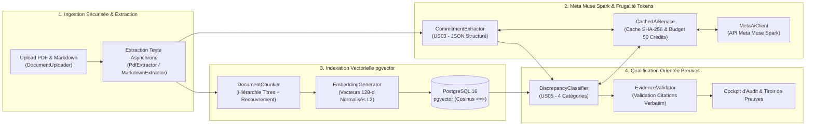

# PromiseGap

> **Votre proposition commerciale annonce 99,99 %. Vos spécifications techniques disent 99,5 %. Détectez les écarts d'engagements avant la signature.**

[](https://www.php.net/)
[](https://symfony.com/)
[](https://github.com/pgvector/pgvector)
[](https://ai.meta.com/)
[](LICENSE)

🌐 **Langues :** [English (README.md)](README.md) | **Français**

---

## 🎯 Pitch & Proposition de Valeur

Dans les négociations B2B, les **propositions commerciales** (rédigées pour remporter l'appel d'offres) et les **spécifications techniques de référence** (rédigées par les équipes d'ingénierie, de sécurité et d'exploitation) divergent fréquemment avant la signature :
- La proposition vend **99,99 % de disponibilité mensuelle**, alors que l'annexe SLA cible **99,5 %** (~3,6 heures contre ~4 minutes d'indisponibilité tolérée par mois).
- La proposition s'engage sur un **déploiement clé en main en 3 mois**, tandis que la feuille de route technique prévoit **7 mois**.
- La proposition promet une **sauvegarde temps réel sans perte de données**, alors qu'aucun objectif RPO ne figure dans les spécifications.

**PromiseGap** est un moteur d'audit contractuel RAG orienté preuves, construit avec **Symfony 8.1**, **PostgreSQL 16 (`pgvector`)** et **Meta Muse Spark**. Il extrait chaque engagement explicite ou implicite des propositions commerciales, recherche les passages techniques correspondants par similarité cosinus et qualifie chaque promesse en quatre catégories accompagnées de **citations verbatim obligatoires** :

| Statut | Signification | Exigence de Preuve |
| :--- | :--- | :--- |
| ⚠️ **CONTRADICTORY** | Conflit direct entre la promesse commerciale et la spécification technique | **Citation verbatim obligatoire** des deux documents |
| 🔴 **UNSUPPORTED** | Promesse fantôme sans fondement dans les spécifications de référence | Signalée avec la section technique la plus proche |
| ❓ **AMBIGUOUS** | Formulation vague (*« performance optimale, de classe mondiale »*) ou cible `TBD` | Mise en évidence pour clarification juridique/CTO |
| 🟢 **SUPPORTED** | Alignement complet confirmé par des paramètres techniques explicites | **Citation verbatim obligatoire** de la spécification |

---

## 🏗️ Architecture Technique



---

## 📊 Résultats du Benchmark d'Évaluation Automatisé

PromiseGap intègre une suite d'évaluation de **24 scénarios synthétiques de contrats B2B** (`tests/Fixtures/scenarios/`) répartis équitablement sur les 4 catégories. Exécutez `php bin/console app:eval-benchmark` pour reproduire ces résultats :

| Catégorie | VP (TP) | FP | FN | Précision | Rappel (Recall) | Score F1 |
| :--- | :---: | :---: | :---: | :---: | :---: | :---: |
| **SUPPORTED** | 6 | 1 | 0 | 85,7 % | 100,0 % | 92,3 % |
| **CONTRADICTORY** | 6 | 0 | 0 | **100,0 %** | **100,0 %** | **100,0 %** |
| **UNSUPPORTED** | 5 | 0 | 1 | **100,0 %** | 83,3 % | 90,9 % |
| **AMBIGUOUS** | 6 | 0 | 0 | **100,0 %** | **100,0 %** | **100,0 %** |
| **MOYENNE MACRO** | **23 / 24** | — | — | **96,4 %** *(cible ≥ 85 %)* | **95,8 %** *(cible ≥ 80 %)* | **95,8 %** |

---

## ⚡ Installation Rapide

### Prérequis
- **PHP 8.4+** avec `pdo_pgsql`, `intl`, `mbstring`
- **Composer 2+**
- **Docker & Docker Compose** (PostgreSQL 16 + `pgvector` et Mailpit)
- **`poppler-utils`** (`pdftotext` pour l'extraction PDF page par page)

### Démarrage avec Docker & Make

```bash
# 1. Démarrer PostgreSQL 16 (avec pgvector) et Mailpit
docker compose up -d

# 2. Installer les dépendances, créer la base et appliquer les migrations
make install
make db-create
make db-migrate

# 3. Lancer le serveur web Symfony (http://localhost:8000)
make serve

# 4. (Optionnel) Lancer le worker Messenger pour l'extraction asynchrone
make worker
```

### Configuration de l'API Meta Muse Spark
Par défaut, PromiseGap fonctionne en **mode simulation déterministe local** lorsque `META_AI_API_KEY` est vide, permettant d'exécuter tous les tests et benchmarks sans consommer de crédits. Pour activer les appels réels à Meta Muse Spark, créez un fichier `.env.local` :

```dotenv
META_AI_API_KEY="votre_cle_api_meta"
META_AI_ENDPOINT="https://api.llama.com/compat/v1"
META_AI_MODEL="Muse-Spark"
```

### Identifiants de Démo (Développement)
- **Compte Auditeur :** `auditor@promisegap.ai` / `password123`
- **Compte Administrateur :** `admin@promisegap.ai` / `admin123`

---

## 🧪 Commandes CLI & Tests

```bash
# Tester la connectivité Meta Muse Spark, le schéma JSON et le suivi du budget de crédits
php bin/console app:test-ai

# Lancer les 24 scénarios d'évaluation RAG et générer eval_report.json
php bin/console app:eval-benchmark

# Exécuter la suite complète de tests PHPUnit (65 tests, 283 assertions)
php bin/phpunit

# Vérifier les linters Symfony (conteneur, Twig, YAML)
make lint
```

---

## 📄 Licence

Ce projet est distribué sous licence MIT — consultez le fichier [LICENSE](LICENSE) pour plus de détails.
