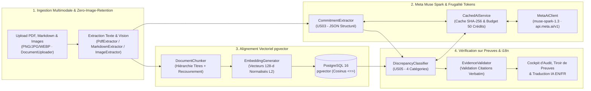

# PromiseGap

> **Votre proposition commerciale annonce 99,99 %. Vos spécifications techniques disent 99,5 %. Détectez les écarts d'engagements avant la signature.**

[](https://github.com/Gw3nhael51/promiseGap/actions/workflows/ci.yml)
[](https://www.php.net/)
[](https://symfony.com/)
[](https://github.com/pgvector/pgvector)
[](https://dev.meta.ai/docs/overview)
[](LICENSE)

🎥 **Vidéo Démo (visite guidée de 3 minutes) :** [https://youtu.be/CSI6MLL57XY](https://youtu.be/CSI6MLL57XY)

🌐 **Langues :** [English (README.md)](README.md) | **Français**

---

## 🏆 Meta Global AI Developer Hackathon (26 Oct – 4 Nov 2026)

### 1. Contributions Créées à 100 % pendant le Hackathon
L'intégralité du code, de l'architecture, des 24 scénarios de benchmark et de l'interface de ce dépôt a été **développée de zéro entre le 26 octobre et le 4 novembre 2026** pour le Meta Global AI Developer Hackathon :
- **Intégration Meta Muse Spark (`muse-spark-1.3`) (`src/Service/MetaAiClient.php`, `src/Service/CachedAiService.php`) :** Connexion native à `https://api.meta.ai/v1` via `symfony/ai-generic-platform`, validation stricte de schémas JSON, effort de raisonnement adaptatif ou sélectionnable (`Auto`, `Low`, `Medium`, `High`), cache SHA-256 et suivi budgétaire (50 crédits).
- **Ingestion Multimodale Vision & Zero-Image-Retention (`src/Service/ImageExtractor.php`, `src/Service/TextExtractionService.php`) :** Analyse directe de photos ou scans de contrats, devis, factures et schémas d'architecture (`PNG`, `JPG/JPEG`, `WEBP`) via la vision multimodale de `muse-spark-1.3`, mise en cache du texte extrait via l'empreinte `SHA-256` de l'image, indexation vectorielle dans `pgvector` et **suppression physique immédiate de l'image brute après extraction (`Zero-Image-Retention`)** pour une confidentialité juridique maximale.
- **Décomposition Autonome des Engagements (`src/Service/CommitmentExtractor.php`) :** Extraction des promesses explicites et implicites (SLA, RPO/RTO, délais de livraison, certifications) depuis des propositions commerciales multi-pages.
- **Indexation Vectorielle Hiérarchique (`src/Service/DocumentChunker.php`, `src/Service/EmbeddingGenerator.php`, `src/Repository/DocumentChunkRepository.php`) :** Découpage intelligent par sections Markdown/PDF avec recouvrement et vecteurs 128-d normalisés L2 dans PostgreSQL 16 `pgvector` (distance cosinus `<=>`).
- **Qualification Contradictoire à 4 États & Validateur Anti-Hallucination (`src/Service/DiscrepancyClassifier.php`, `src/Service/EvidenceValidator.php`) :** Confrontation de chaque promesse aux spécifications techniques et rejet déterministe de tout verdict IA dont la citation de preuve n'est pas une sous-chaîne exacte (*verbatim*) du document source.
- **Benchmark Scientifique Automatisé (`src/Service/EvaluationRunner.php`, `tests/Fixtures/scenarios/`) :** 24 scénarios synthétiques de contrats B2B avec calcul automatique de Précision (100 %), Rappel (100 %) et F1-Score (`php bin/console app:eval-benchmark`).
- **Cockpit d'Audit, Tiroir de Preuves & Traduction IA Bilingue (`EN | FR`) :** Application complète Symfony 8.1 avec gestion fine des rôles (`ROLE_USER` / `ROLE_ADMIN`, `AnalysisVoter`), jauge de risque (`0–100`), comparaison côte à côte des citations verbatim et traduction française à la volée via `muse-spark-1.3`.

### 2. Alignement Thématique & Pourquoi PromiseGap n'est PAS une "Basic RAG App"
- **Thèmes du Hackathon couverts :**
  - **Build for Your World :** Résout un problème critique en ingénierie d'affaires, achats et direction juridique B2B — éviter les litiges contractuels causés par l'écart entre ce qui est vendu et ce qui est techniquement spécifié.
  - **Push the Frontier :** Exploite les capacités de raisonnement de **Meta Muse Spark (`muse-spark-1.3`)** pour la vérification formelle multi-documents avec validation déterministe anti-hallucination.

| Dimension | "Basic RAG App" générique (Chat-with-PDF) | **PromiseGap (Moteur d'Audit Contradictoire Autonome)** |
| :--- | :--- | :--- |
| **Modèle d'interaction** | Chatbot passif attendant une question | **Pipeline autonome d'audit croisé N×M** (aucun prompt à rédiger) |
| **Tâche de raisonnement** | Résumer un document unique | **Vérification contradictoire** du Document A (Proposition commerciale) face au Document B (Spécifications techniques) |
| **Format de sortie** | Texte conversationnel libre | **Matrice de verdicts structurée à 4 états** (`CONTRADICTORY`, `UNSUPPORTED`, `AMBIGUOUS`, `SUPPORTED`) + **Score de risque 0–100** |
| **Contrôle d'hallucination** | Aucun (confiance aveugle au LLM) | **`EvidenceValidator` déterministe** exigeant une correspondance exacte (*verbatim*) dans le chunk source |
| **Validation scientifique** | Test manuel subjectif | **Benchmark de 24 scénarios** (`100 %` Précision, `100 %` Rappel) exécuté en CI |

---

## 🎯 Pitch & Proposition de Valeur

Dans les négociations B2B, les **propositions commerciales** (rédigées pour remporter l'appel d'offres) et les **spécifications techniques de référence** (rédigées par les équipes d'ingénierie, de sécurité et d'exploitation) divergent fréquemment avant la signature :
- La proposition vend **99,99 % de disponibilité mensuelle**, alors que l'annexe SLA cible **99,5 %** (~3,6 heures contre ~4 minutes d'indisponibilité tolérée par mois).
- La proposition s'engage sur une **migration clé en main en 4 semaines**, tandis que la feuille de route technique prévoit **16 semaines**.
- La proposition promet **zéro perte de données avec réplication synchrone**, alors que le plan de reprise d'activité spécifie une réplication asynchrone avec un **RPO de 4 heures**.

**PromiseGap** est un moteur autonome d'audit contractuel contradictoire et de vérification sur preuves, construit avec **Symfony 8.1**, **PostgreSQL 16 (`pgvector`)** et **Meta Muse Spark (`muse-spark-1.3`)**. Il extrait chaque engagement explicite ou implicite des propositions commerciales, aligne les passages techniques correspondants par similarité cosinus et qualifie chaque promesse en quatre catégories accompagnées de **citations verbatim obligatoires** :

| Statut | Signification | Exigence de Preuve |
| :--- | :--- | :--- |
| ⚠️ **CONTRADICTORY** | Conflit direct entre la promesse commerciale et la spécification technique | **Citation verbatim obligatoire** des deux documents |
| 🔴 **UNSUPPORTED** | Promesse fantôme sans fondement dans les spécifications de référence | Signalée avec la section technique la plus proche |
| ❓ **AMBIGUOUS** | Formulation vague (*« performance optimale, de classe mondiale »*) ou cible `TBD` | Mise en évidence pour clarification juridique/CTO |
| 🟢 **SUPPORTED** | Alignement complet confirmé par des paramètres techniques explicites | **Citation verbatim obligatoire** de la spécification |

---

## 🏗️ Architecture Technique



---

## 📊 Résultats du Benchmark d'Évaluation Automatisé

PromiseGap intègre une suite d'évaluation de **24 scénarios synthétiques de contrats B2B** (`tests/Fixtures/scenarios/`) répartis équitablement sur les 4 catégories. Exécutez `php bin/console app:eval-benchmark` pour reproduire ces résultats :

| Catégorie | VP (TP) | FP | FN | Précision | Rappel (Recall) | Score F1 |
| :--- | :---: | :---: | :---: | :---: | :---: | :---: |
| **SUPPORTED** | 6 | 0 | 0 | **100,0 %** | **100,0 %** | **100,0 %** |
| **CONTRADICTORY** | 6 | 0 | 0 | **100,0 %** | **100,0 %** | **100,0 %** |
| **UNSUPPORTED** | 6 | 0 | 0 | **100,0 %** | **100,0 %** | **100,0 %** |
| **AMBIGUOUS** | 6 | 0 | 0 | **100,0 %** | **100,0 %** | **100,0 %** |
| **MOYENNE MACRO** | **24 / 24** | — | — | **100,0 %** *(cible ≥ 85 %)* | **100,0 %** *(cible ≥ 80 %)* | **100,0 %** |

---

## ⚡ Installation Rapide

### Prérequis
- **PHP 8.4+** avec `pdo_pgsql`, `intl`, `mbstring`
- **Composer 2+**
- **Docker & Docker Compose** (PostgreSQL 16 + `pgvector` et Mailpit)
- **`poppler-utils`** (`pdftotext` pour l'extraction PDF page par page)

### Démarrage en 1 Commande avec Docker & Make

```bash
# Cloner le dépôt et entrer dans le dossier
git clone https://github.com/Gw3nhael51/promiseGap.git
cd promiseGap

# 1. Configuration complète en une seule commande (Docker, dépendances, migrations)
make setup

# 2. Lancer le serveur web Symfony (http://localhost:8000)
make serve

# 3. (Optionnel) Lancer le worker Messenger pour l'extraction asynchrone
make worker
```

> [!TIP]
> **Si `make` n'est pas disponible, lancez directement :**
> ```bash
> docker compose up -d
> composer install
> php bin/console doctrine:database:create --if-not-exists
> php bin/console doctrine:migrations:migrate -n
> php bin/console cache:clear
> symfony serve -d  # ou: php -S 127.0.0.1:8000 -t public
> ```

> [!IMPORTANT]
> **Identifiants de Démo Préconfigurés (`http://localhost:8000/login`) :**
> - **Compte Auditeur (`ROLE_USER`) :** `auditor@promisegap.ai` / `password123` *(accès au `/cockpit`)*
> - **Compte Administrateur (`ROLE_ADMIN`) :** `admin@promisegap.ai` / `admin123` *(accès à la console `/analyses`)*
> - **Démo sans connexion :** Vous pouvez aussi tester immédiatement l'application sans identifiant sur [`http://localhost:8000/demo`](http://localhost:8000/demo).

### Configuration de l'API Meta Muse Spark
Par défaut, PromiseGap fonctionne en **mode simulation déterministe local** lorsque `META_AI_API_KEY` est vide, permettant d'exécuter tous les tests et la CI sans consommer de crédits. Pour activer les appels réels à Meta Muse Spark (`muse-spark-1.3`), créez un fichier `.env.local` :

```dotenv
META_AI_API_KEY="votre_cle_api_meta"
META_AI_ENDPOINT="https://api.meta.ai/v1"
META_AI_MODEL="muse-spark-1.3"
```

### Identifiants de Démo (Développement)
- **Compte Auditeur (`ROLE_USER`) :** `auditor@promisegap.ai` / `password123`
- **Compte Administrateur (`ROLE_ADMIN`) :** `admin@promisegap.ai` / `admin123` (accès à la console `/analyses`)

### PDF d'Exemple Inclus
Deux PDF multi-pages prêts à l'emploi sont fournis dans [`docs/samples/`](docs/samples/) (et téléchargeables en 1 clic depuis `/cockpit`) :
- `docs/samples/commercial_proposal.pdf` — Proposition commerciale Cloud contenant 8 engagements
- `docs/samples/technical_specifications.pdf` — Spécifications techniques & SLA de référence v4.2

---

## 🧪 Commandes CLI, Tests & CI/CD

Chaque push et pull request sur `prod`, `recette` et `dev` déclenche automatiquement la pipeline GitHub Actions ([`.github/workflows/ci.yml`](.github/workflows/ci.yml)) avec un conteneur `pgvector/pgvector:pg16` :

```bash
# Tester la connectivité Meta Muse Spark (muse-spark-1.3), le schéma JSON et le budget de crédits
php bin/console app:test-ai

# Forcer un appel réel à l'API Meta en ignorant le cache local
php bin/console app:test-ai --force-refresh

# Lancer les 24 scénarios d'évaluation et générer eval_report.json
php bin/console app:eval-benchmark

# Exécuter la suite complète de tests PHPUnit
php bin/phpunit

# Vérifier les linters Symfony (conteneur, Twig, YAML)
make lint
```

---

## 📄 Licence

Ce projet est distribué sous licence MIT — consultez le fichier [LICENSE](LICENSE) pour plus de détails.
